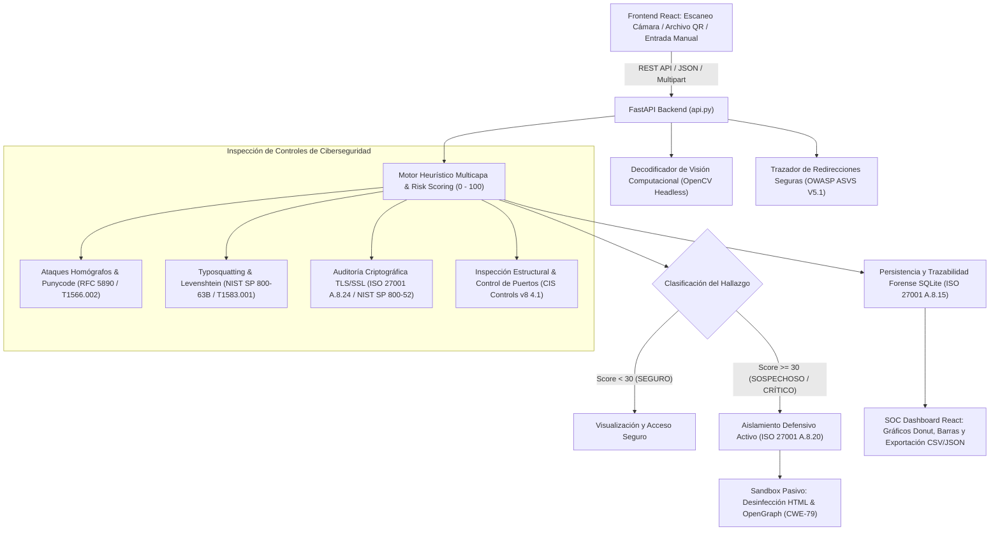

# 🛡️ PhishHunter Live
### Sistema de Inspección Heurística y Aislamiento Preventivo contra Amenazas de Quishing mediante Visión Computacional (React + FastAPI)

[](https://react.dev/)
[](https://fastapi.tiangolo.com/)
[](https://www.python.org/)
[](https://opencv.org/)
[]()
[]()

---

## 📌 1. Visión General y Arquitectura

**PhishHunter Live** es una plataforma de ciberdefensa orientada a Centros de Operaciones de Seguridad (SOC), analistas de incidentes y laboratorios forenses. Su objetivo es detectar, mitigar y contener de forma preventiva amenazas de **Quishing** (Phishing vehiculizado mediante códigos QR).

El sistema cuenta con una arquitectura desacoplada y moderna:
- **Frontend SOC en React (Vite)**: Interfaz interactiva Glassmorphism con escaneo de cámara web en vivo, subida de archivos, dashboard forense con gráficos analíticos, catálogo normativo y laboratorio de vectores de ataque.
- **Backend de Alta Velocidad en FastAPI**: Expone endpoints REST para decodificación con **OpenCV Headless**, trazabilidad de redirecciones HTTP salto a salto, auditoría criptográfica TLS, cálculo de Risk Score heurístico y persistencia inmutable en **SQLite**.



---

## 🏛️ 2. Mapeo Exhaustivo de Controles de Seguridad y Estándares

PhishHunter Live fue diseñado bajo estrictos criterios de auditoría y controles de seguridad de la información:

| Estándar / Marco | Control / Requisito | Mecanismo de Mitigación en PhishHunter Live |
| :--- | :--- | :--- |
| **ISO/IEC 27001:2022** | **A.8.15** (Registro de Auditoría y Trazabilidad) | Persistencia local en SQLite (`phishhunter.db`), registrando ID, timestamp UTC, payload original, URL final, saltos, score, desglose en JSON e IP cliente. |
| **ISO/IEC 27001:2022** | **A.8.20** (Seguridad en Redes y Aislamiento) | Bloqueo preventivo incondicional de hipervínculos cuando el Risk Score es $\ge 30$, forzando inspección a través del Sandbox Pasivo. |
| **ISO/IEC 27001:2022** | **A.8.24** (Uso de Criptografía) | Verificación de obligatoriedad de HTTPS, auditoría de certificados SSL/TLS y detección de degradación criptográfica (*SSL Strip*). |
| **OWASP ASVS v4.0** | **V5.1 / CWE-601** (Open Redirects) | Rastreo controlado salto a salto (301, 302, 307, 308) con timeout estricto de 4.0s, User-Agent neutro y detección de pivoteo entre dominios no relacionados. |
| **OWASP Top 10** | **CWE-79** (Cross-Site Scripting) | Purgado total de etiquetas `<script>`, `<iframe>`, `<object>`, atributos interactivos (`onclick`, etc.) y desactivación de formularios en el Sandbox. |
| **NIST SP 800-63B** | Mitigación de Impersonación | Algoritmo de distancia de edición de Levenshtein contra catálogo oficial de marcas bancarias, fintech, corporativas y logísticas. |
| **NIST SP 800-52 Rev. 2** | Transporte TLS y Puertos | Detección de puertos anómalos (ej. `:8080`, `:4444`, `:1337`, `:9000`) y auditoría de suites TLS en destino. |
| **CIS Controls v8** | **Control 4.1** (Configuraciones Seguras) | Alerta crítica por uso directo de direcciones IP numéricas en URLs y penalización de TLDs de alto riesgo estadístico (`.xyz`, `.top`, `.live`, etc.). |
| **RFC 5890 / MITRE** | **T1566.002 / T1583.001** | Detección de ataques homógrafos IDN con prefijo Punycode (`xn--`) y análisis de caracteres confusables no latinos (cirílico/griego). |

---

## 🗂️ 3. Estructura del Proyecto

```
phishhunter-live-react/
├── .env.example               # Variables de entorno modelo (puertos, timeouts, db)
├── .gitignore                 # Exclusiones de Git (node_modules, venv, db)
├── Dockerfile                 # Contenedor multi-stage optimizado (Node + Python 3.11)
├── render.yaml                # Infraestructura como código (IaC) para Render
├── requirements.txt           # Dependencias Python (FastAPI, OpenCV, etc.)
├── package.json               # Scripts de orquestación NPM y arranque
├── start.py                   # Lanzador unificado de servidor (React + FastAPI)
├── api.py                     # API REST FastAPI SOC
├── frontend/                  # Aplicación Frontend en React + Vite
│   ├── package.json           # Dependencias React (Lucide icons, Vite)
│   ├── vite.config.js         # Configuración Vite con proxy a FastAPI
│   ├── index.html             # Entry point con estilos corporativos SOC
│   └── src/
│       ├── main.jsx           # Render React DOM
│       ├── App.jsx            # Contenedor principal y pestañas
│       ├── api.js             # Cliente HTTP REST
│       ├── index.css          # Estilos Glassmorphism y badges de severidad
│       └── components/
│           ├── Sidebar.jsx              # Telemetría y alineación normativa
│           ├── HeaderMetrics.jsx        # KPIs de incidentes y scores
│           ├── ThreatInspectionTab.jsx  # Escaneo cámara, archivo, trazado y sandbox
│           ├── ForensicDashboardTab.jsx # Gráficos analíticos y bitácora SQLite
│           ├── ComplianceCatalogTab.jsx # Fichas de controles de seguridad
│           └── LabSamplesTab.jsx        # Laboratorio de vectores sintéticos
├── database/
│   ├── __init__.py
│   └── db_manager.py          # Gestor SQLite thread-safe y exportación CSV/JSON
├── core/
│   ├── __init__.py
│   ├── qr_decoder.py          # Extracción y decodificación de QR con OpenCV
│   ├── url_tracer.py          # Trazador de redirecciones HTTP y auditoría TLS
│   ├── heuristic_engine.py    # Motor de cálculo de Risk Score (0-100) y controles
│   └── sandbox_preview.py     # Sandbox pasivo con desinfección HTML y OpenGraph
├── utils/
│   ├── __init__.py
│   └── threat_signatures.py   # Catálogo de marcas protegidas, homógrafos y TLDs
└── tests/
    ├── __init__.py
    ├── test_api.py            # Pruebas de integración de la API REST y React
    └── test_heuristics.py     # Pruebas deterministas de controles heurísticos
```

---

## 🚀 4. Guía de Ejecución Local

### Prerrequisitos
- **Python 3.11** o superior.
- **Node.js v18+** y **npm**.

### Opción 1: Inicio Rápido Unificado (Recomendado)
Un único comando sirve tanto la API de seguridad como la aplicación React en `http://localhost:8000`:

```bash
python start.py
```
*(Si es la primera vez que se ejecuta, compilará automáticamente el frontend React).*

### Opción 2: Modo Desarrollo Separado (Hot-Reload)
Si desea realizar modificaciones en vivo en el código de React o en el Backend:

1. **Terminal 1 (Backend FastAPI con recarga en vivo):**
   ```bash
   uvicorn api:app --reload --port 8000
   ```

2. **Terminal 2 (Frontend React Vite con Hot-Module-Replacement):**
   ```bash
   cd frontend
   npm run dev
   ```
   > El servidor de desarrollo de Vite se abrirá en `http://localhost:3000` con proxy automático a la API.

---

## 🧪 5. Pruebas Automatizadas

El proyecto incluye 21 pruebas deterministas con `pytest` que validan el motor heurístico, la persistencia en base de datos, el decodificador de visión computacional y los endpoints de la API REST:

```bash
pytest -v
```

Salida esperada:
```text
tests/test_api.py::test_api_health PASSED
tests/test_api.py::test_api_stats PASSED
tests/test_api.py::test_lab_samples_and_qr_generation PASSED
tests/test_api.py::test_analyze_endpoint PASSED
tests/test_api.py::test_audit_logs_and_exports PASSED
tests/test_api.py::test_react_spa_served PASSED
tests/test_heuristics.py::test_levenshtein_distance_algorithm PASSED
...
============================= 21 passed in ~2s =============================
```

---

## 🐳 6. Ejecución en Contenedor Docker

El proyecto cuenta con un `Dockerfile` optimizado en dos etapas (multi-stage) que compila el frontend en Node y lo ejecuta en un entorno liviano `python:3.11-slim`:

### Construcción:
```bash
docker build -t phishhunter-react:latest .
```

### Ejecución:
```bash
docker run -d -p 8000:8000 --name phishhunter-react phishhunter-react:latest
```
Acceda a la aplicación en `http://localhost:8000`.

---

## ☁️ 7. Despliegue en Render

El repositorio incluye el archivo `render.yaml` preconfigurado:
1. Conecte este repositorio en [Render.com](https://render.com/).
2. Render ejecutará la etapa de build compilando el frontend React con `npm run build` e instalando las librerías de Python.
3. El comando de inicio `uvicorn api:app --host 0.0.0.0 --port $PORT` levantará la aplicación completa en un único puerto web.

---

## 🛡️ 8. Motor de Ponderación de Riesgo (Risk Scoring Engine)

| Categoría | Rango de Puntuación | Color / Insignia | Acción Defensiva Ejecutada |
| :--- | :---: | :---: | :--- |
| **SEGURO** | $0 \le \text{Score} < 30$ | 🟢 Verde | Conexión confiable sin indicadores de compromiso. Se habilita acceso seguro. |
| **SOSPECHOSO** | $30 \le \text{Score} < 70$ | 🟡 Amarillo | Anomalías estructurales o de red presentes. Se activa el **Sandbox Pasivo** y se neutralizan enlaces. |
| **CRÍTICO / QUISHING** | $70 \le \text{Score} \le 100$ | 🔴 Rojo | Confirmación de ataque (homógrafo, typosquatting o suplantación deliberada). **Aislamiento preventivo total**. |

---

## ⚖️ Licencia y Propósito Educativo / Forense
Este proyecto se distribuye para fines de investigación en ciberseguridad, análisis forense de incidentes y protección preventiva de infraestructuras corporativas contra campañas de ingeniería social por QR.
